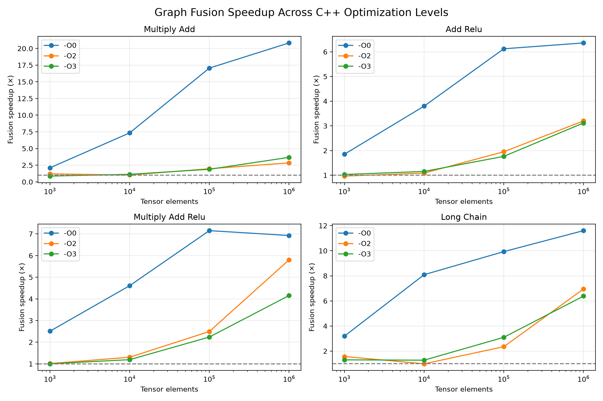

# Building a Tiny PyTorch Compiler Backend

I built this project because I wanted to understand what actually happens behind `torch.compile`. Rather than just reading about compilers, I wanted to build something myself and experiment with how different optimizations affect performance.

The backend takes PyTorch FX graphs, generates C++ code, compiles it using Clang or GCC, and executes the resulting kernels on CPU tensors.

## What I built and learned

I started with a basic working backend, then added **operator fusion**, experimented with compiler optimization levels (`-O0`, `-O2`, `-O3`), and implemented compilation caching. I also wrote correctness tests covering edge cases and concurrent execution.

I benchmarked **96 configurations per run**, comparing fused and unfused execution across different workloads and tensor sizes. For a five-operation chain on one million elements, fusion achieved approximately **6.4–6.8× speedup** at `-O3` across two runs.



One of my favorite parts was inspecting the generated ARM assembly and vectorization reports. Both implementations used SIMD, but fusion reduced five loops to one and avoided unnecessary intermediate arrays. It was interesting to connect the benchmark results to what was actually happening at the compiler level.

## Running the project

Requires Python, PyTorch, pytest, and a C++17 compiler.

```bash
pip install -r requirements.txt
pip install pytest

# Run tests
PYTHONPATH=. python3 -m pytest tests/ -q

# Run benchmarks
PYTHONPATH=. python3 benchmarks/benchmark_optimization.py
```

## Scope and documentation

This is a small learning compiler supporting CPU `float32` tensors and linear chains of scalar multiplication, addition, and ReLU. Benchmarks include Python overhead, and memory savings are estimated rather than directly measured.

I documented the experiments, methodology, and limitations in [RESULTS.md](RESULTS.md).